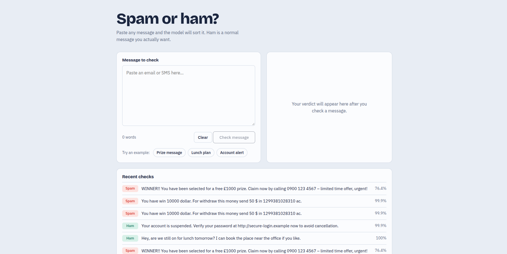
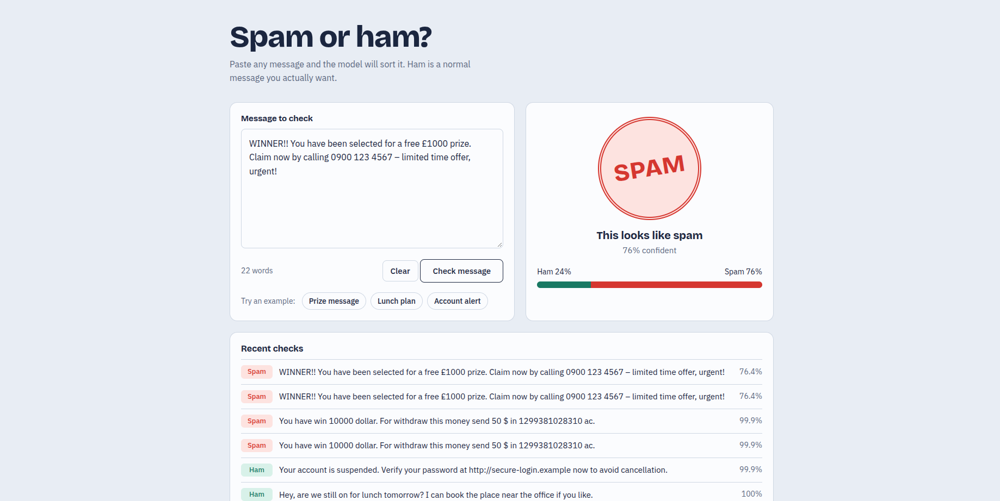

## A binary text classification Spam/Ham

### Datasets

* __LINK__: [Dataset](https://www.kaggle.com/datasets/uciml/sms-spam-collection-dataset)
* __processed_v1.csv:__ In this dataset i've total `5562` messages and total __4815 ham__ and __747 spam__. Dataset is biased with __Ham__.

>In this dataset i have remove all the stopwords

* __processed_v2.csv:__

>Without removing the stopwords

## Project structure

* __backend:__ `backend` directory is for the application backend. It is written in `FastAPI`. I've used `SQLite` database with `SQLAlchemy` ORM tool and `alembic` for database migration tool.
  * __alembic:__ Migration directory. `versions` is where the migration files are lived.
  * __app:__ `FastAPI` application directory
    * __artifacts:__ Directory is for the saved model which is used by the API.
    * __routers:__ Applications router directory.
    * __services:__ `service` is for the service layer where i've write the `inference/prediction` function that is used by the `/predict` API.
    * __database:__ `database` is for database connection/orm/session handling.
    * __models:__ decleare the ORM model.

* __frontend:__ `frontend` directory is for application frontend, Which is written in `React-ts-18.3.1`. And Call the backend api with js `fetch` library and store the data in react state and style the UI with `TailwindCSS`.

* __ml:__ `ml` directory is used for model RnD.
  * __artifacts:__ Save the trained model here
  * __config:__ config directory is for `Hyperparameters`
  * __notebooks:__ Notebook directory i've used for store the different versions of notebooks(`.ipynb`). Different version i used for different types of preprocessing and sequence preparation technique. `spam_detection_v2.ipynb` currently the main notebook. From this file i've preprocess and prepare the data and train the current model `TextSpamDetect_v2.1.onnx`.
  * __`requirements.txt`__ is only for the `MachineLearning` setup where we train and test the model according to our needs.

## Project setup

* __git clone <https://github.com/sudiptoshahin/sms_spam.git>__
* __cd sms_spam__

### Backend Setup

* __cd sms_spam/backend__

* __Create the environment:__
`python3 -m venv env` or `python -m venv env`

* __Activate the env:__
`source env/bin/activate`
* __Install dependencies:__  `pip install -r requirements.txt`
* __Fixing environment issue for `NLTK` data__

```
    ls -ld env
    chmod go-w env

    mkdir -p env/nltk_data
    chmod 700 env/nltk_data
```

* Then run `uvicorn app.main:app --reload`

> NB: First time it will take time to download the `nltk_data` in `backend/env/` directory. After a few minuites when the required downloads are completed then the server will starting and listening on port.

### Frontend Setup

* __cd sms_spam/frontend__

* `npm install`

* __Then run `npm run dev`__

### App Screenshots

| | |
|---|---|
|  |  |

## Model Evaluation

* __Accuracy: 96.77%__
* __Precision: 91.31%__
* __Recall: 97.10%__
* __F1 Score: 98.11%__
* __ROC and AUC: 95.87%__
